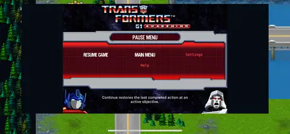

# Transformers: G1 Awakening — iOS

### The original G1 tactical adventure, rebuilt for iPhone and iPad.

**Native restoration and modernization by [iammrmikeman](https://github.com/iammrmikemanmods)**

Native ARM64 · Metal · Classic & Modern · iPhone & iPad

[Releases](https://github.com/iammrmikemanmods/G1-Awakening-IOS/releases) · [Install](docs/INSTALL.md) · [Screenshots](docs/SCREENSHOTS.md) · [Source](https://github.com/iammrmikemanmods/G1-Awakening-IOS/tree/be203a911bc26313615ea450758413e5c9cf6462) · [Roadmap](docs/ROADMAP.md)

**G1 Awakening iOS** reconstructs the original mobile game as a native 64-bit application, preserving its missions, characters, turn-based rules and bright Generation 1 identity. The runtime is C++/Objective-C++ with Metal rendering—not a packaged ARM32 emulator. It does not need a JIT session.

> **Development preview.** The full packaged resource revision is **v0.17.0-r1**, previously called **017R1**. Earlier native gameplay was demonstrated on an iPhone XR; this exact package and its complete campaign still need device validation. Compiled minimum: **iOS/iPadOS 15.0**. [Status and limitations](docs/STATUS.md).

## Get the game

<!-- playable-release:start -->
**Complete IPA filename: `G1-Awakening-iOS-v0.17.0-r1.ipa`** — 37.69 MB.

**The complete IPA attachment is still pending.** The existing `v0.17.0-dev1` release contains source/native code only, not an installable game. Do not download a source ZIP expecting it to install. The verified complete package has been prepared under the public filename above; [release publication instructions](docs/PUBLISHING.md) cover uploading and checking it.
<!-- playable-release:end -->

The Home Screen name is **G1 Awakening**. The app's internal version remains **0.17.0 / build 17**; `r1` denotes the resource revision. Renaming the download does not change its signing, save identity or runtime. [Release details and checksum](docs/releases/v0.17.0-r1.md).

## Real iPhone XR captures

Four distinct views from the native iOS port: tactical play, story dialogue, the main menu and the pause menu. These are supplied **earlier UI-restoration captures**, associated with Build 012—not current-remaster promotional renders. Old layout defects are visible and have not been painted out.

| Restored original main menu | Pause menu over the live map |
| :---: | :---: |
|  |  |

[Open the gallery and capture provenance](docs/SCREENSHOTS.md). Current-build combat, transformation, Tech Specs and later-mission captures are still needed. Original-PC footage, generated art boards and CPU previews are not labelled as iOS gameplay.

## Classic identity. Modern presentation.

| System | Classic | Modern |
| --- | --- | --- |
| Gameplay | Original mission and turn rules | The same rules and saves |
| Interface | Shared adaptive HUD and installed UI remasters | The same shared UI improvements |
| Tactical Transformers | Original sprites | Supported original 3D forms with authored walking/transformation presentation |
| World artwork | Original materials | Installed source-mapped replacement textures; full art pass ongoing |
| Rendering | Native-resolution scene | Default supersampling request with resource/thermal fallbacks |
| Shadows | Original-style presentation | Added soft contact shadows, not complete directional/self-shadowing |

The development runtime includes Story, Showdown and Arena flows, tactical actions, original-data battles, Tech Specs, sound/music paths and checkpoint saving. Authored transformations are approximations; unsupported states can fall back to sprites. Automated tests do not replace a rendered full-campaign playthrough.

The visual target is **bright, faithful G1 HD-2D**: clean mechanical UI, readable Transformers, restrained grass, blue water and vivid faction colours. No heavy fog, invented wear or generic replacement art. Individual source masters, mappings and seam checks—not concept boards—form the remaster library.

## Installation

Use a complete IPA and an installer/signing route compatible with your exact device and OS. None lowers the game's compiled minimum.

| Route | Important distinction |
| --- | --- |
| **TrollStore** | Standard TrollStore supports only specific OS builds; stock iOS 17.5.1 is not one of them. TrollStore Lite is a separate jailbreak-dependent route. |
| **AppSync Unified + Filza** | Requires an already working compatible jailbreak/bootstrap and AppSync package. The IPA retains an ad-hoc signature. |
| **Sideloadly** | Re-sign/provision the complete IPA with an Apple ID on Windows/macOS. This exact release route is not yet device-verified. |

### [Read the step-by-step installation guide](docs/INSTALL.md)

Back up saves before upgrading. Keep the same signing identity/installer where possible. **Do not uninstall to troubleshoot an update**; local saves may be removed.

## Source, releases and ongoing work

[Exact Build 017 runtime source](https://github.com/iammrmikemanmods/G1-Awakening-IOS/tree/be203a911bc26313615ea450758413e5c9cf6462) · [Development PR #13](https://github.com/iammrmikemanmods/G1-Awakening-IOS/pull/13) · [Build instructions](docs/BUILDING.md)

`main` still contains an earlier engine checkpoint plus this public-facing documentation. Updating the front page did not merge the unverified development stack. Use the pinned source when reproducing the current package. The release Source ZIP additionally contains the 017R1 packaging/recovery work.

The Block 1 art checkpoint contains **72 review-pending candidates** in a separate package; it is not all included in v0.17.0-r1. Visual terrain extensions remain proposals, not larger playable maps. The original navigation, objectives, collision and saves must stay intact.

[Roadmap](docs/ROADMAP.md): finish original UI/HUD/effects; polish each character's motion; finish the faithful asset library; integrate detailed visual exteriors; expand physical-device testing. Legacy iOS 7–14 and other Apple platforms are goals, not current compatibility claims.

## Testing and contributions

[Report a bug](https://github.com/iammrmikemanmods/G1-Awakening-IOS/issues/new/choose) with the exact IPA/resource revision, device, OS, installer, graphics mode, mission and reproduction steps. Include a screenshot or short recording where useful. Remove private account information, passwords and signing tokens.

## Credits and licensing

Project direction, port and remaster work: **iammrmikeman**. Original game, characters, artwork and music belong to their respective rights holders. Independent fan preservation project; not an official Hasbro or Glu release.

New project code uses [MPL-2.0](LICENSE); third-party components retain their licences. This does not relicense original assets, music, trademarks or screenshots. Do not post game dumps, credentials or private saves in issues.

Updated 31 October 2026. Earlier engineering notes: <a href="docs/history/README-before-public-page.md">archived README</a>.
