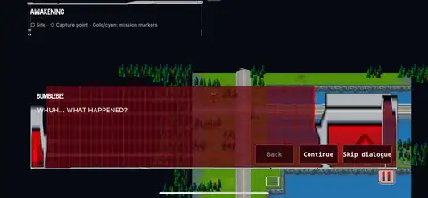

# Native iPhone XR gallery

[Back to the project](../README.md) · [Install](INSTALL.md)

These are genuine device captures supplied by iammrmikeman from the native iOS port, associated in the project conversation with **Build 012**. The build number is not embedded in the pictures. They demonstrate earlier native execution—not the appearance or full-campaign stability of v0.17.0-r1.

## Mission 1 — tactical gameplay

The tactical map with the mission objective and action controls visible. Earlier camera/layout issues and black map boundaries are retained, not painted out.

## Mission 1 — story dialogue

A different gameplay state: Bumblebee's opening dialogue over the map. This shows the older oversized dialogue UI, not the revised Build 013+ panel.

## Original-menu restoration

The original red-and-silver menu artwork in the native app. This is a menu capture, not tactical gameplay.

## Pause menu over the tactical map

Pause/navigation with the mission world visible underneath. It is not an additional mission or combat camera.

## Capture selection and editing

Only proportional resizing and WebP compression were applied. No generated scenery, UI replacements, background cleanup, crop, fog, recolouring or model swaps. The near-duplicate Ratchet dialogue screenshot was deliberately omitted rather than padding the gallery. The supplied intro still is cinematic media, not gameplay; the original-PC recording and original stats references are not native iOS captures.

The first two existing images retain their [original provenance record](media/PROVENANCE.json). The dialogue/pause exports have [input/output hashes and dimensions](media/XR_GALLERY_ADDITIONS.json). Full-size original dialogue/pause captures are retained in the conversation's release-publication kit.

## New captures needed for the current build

A current XR recording should demonstrate tactical selection/movement, a close-up attack with damage feedback, an authored transformation, Tech Specs, and a visibly different later mission. Extract one clear frame per distinct state, label build/device/OS/mode, and keep the full original recording as provenance. These scenes are a capture checklist, not claims that screenshots already exist.

Do not substitute concept art, CPU pose previews or original-PC footage for missing current iOS screenshots.
