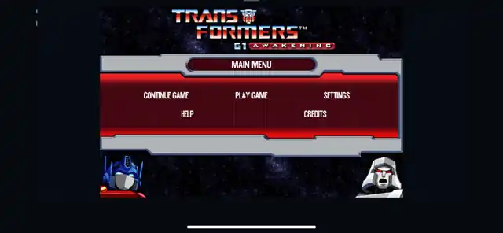
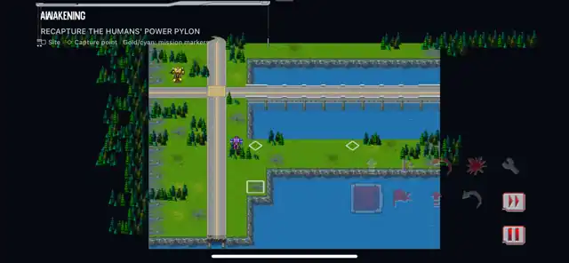

# Screenshots and media provenance

[Back to the project](../README.md)

## Real iPhone XR captures

The maintainer supplied these from the native iOS build running on an iPhone XR. The conversation associates them with the earlier Build 012 checkpoint; the exact build number is not visibly embedded in the images. They demonstrate earlier native execution, not the current 017R1 package, final UI parity or full campaign completion.

### Main menu

### Mission 1

Only resizing and WebP compression were applied for the repository page. No crop, paint-over, fog, replacement HUD, generated scenery or lighting correction was added. Black borders, old diagnostic/layout elements and incomplete artwork remain visible because they were present in the supplied captures.

Exact input/output hashes and dimensions: [PROVENANCE.json](media/PROVENANCE.json).

## What belongs in this gallery

Label new captures with build/resource revision, device, OS, Classic/Modern mode and whether the image is a native device capture, a simulator capture, an actual processed texture comparison or a CPU model review. Keep those categories separate.

Generated style boards are art-direction references, not screenshots or replacement-asset QA. Before/after comparisons must use actual original and exported files at matched scale. A newer release needs its own captures; do not relabel these older images as proof of its appearance.
